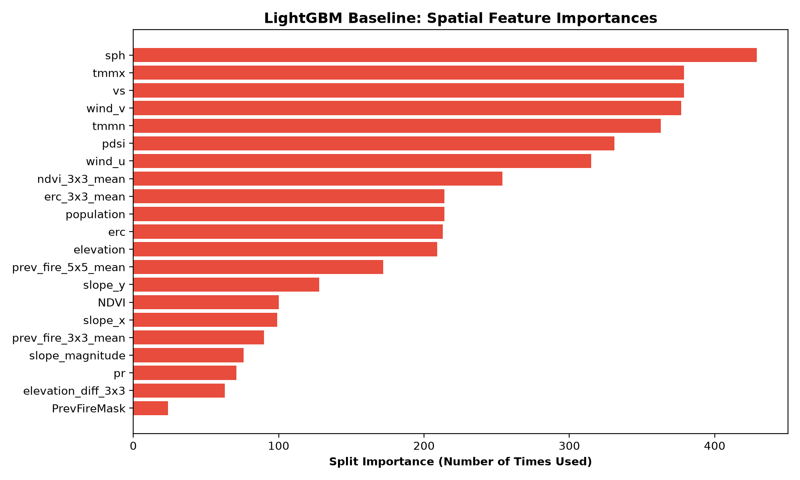

# 🛰️ Next Day Wildfire Spread Prediction via Spatial Deep Learning & AML

[](https://github.com/14-himanshu/wildfire-spread-prediction/actions/workflows/ci.yml)
[](https://www.python.org/)
[](https://pytorch.org/)
[](https://lightgbm.readthedocs.io/)
[](https://opensource.org/licenses/MIT)

An end-to-end multimodal machine learning system that predicts next-day wildfire propagation from remote sensing satellite imagery, atmospheric weather reanalysis grids, and digital elevation models.

Combines an engineered **tabular spatial baseline (LightGBM)** with a **spatiotemporal deep learning model (PyTorch U-Net)** using **Masked Focal-Tversky Loss** to tackle severe 99.7% pixel class imbalance.

---

## 📌 Problem Formulation & Physical Dynamics

Wildfire propagation is governed by fluid dynamics (advection), thermodynamics (slope heat preheating), and combustion chemistry:
- **Spatial Resolution:** $64 \times 64\text{ km}$ tiles at $1\text{ km/pixel}$ resolution ($4,096$ coupled spatial decisions per tile).
- **Target:** Predict active wildfire boundary at Day $T+1$ given environmental states at Day $T$.
- **Class Imbalance:** Active burning pixels represent $<0.3\%$ of observable land.

### Real Wildfire Spread & Wind Vector Overlay

*Figure: Day T fire perimeter (gold dashed line) vs. Day T+1 ground truth spread (red line) overlaid on elevation topography with decomposed zonal/meridional wind quiver arrows.*

---

## 🛰️ Multimodal Remote Sensing Bands (12 Channels)


1. **`elevation`**: Topography DEM in meters (fire accelerates uphill).
2. **`NDVI`**: Normalized Difference Vegetation Index (fuel & biomass density).
3. **`pdsi`**: Palmer Drought Severity Index (long-term soil/fuel dryness).
4. **`erc`**: Energy Release Component (NFDRS fire potential index).
5. **`vs`**: Wind velocity at 10m ($m/s$).
6. **`th`**: Wind direction azimuth ($0^\circ - 360^\circ$).
7. **`tmmn` / `tmmx`**: Minimum and maximum daily temperature (Kelvin).
8. **`sph`**: Specific humidity ($kg/kg$).
9. **`pr`**: Daily precipitation ($mm$).
10. **`population`**: Human population density ($/km^2$).
11. **`PrevFireMask`**: Active fire detection mask at Day $T$ (binary $\{0, 1\}$).
12. **`FireMask`** *(Target)*: Active fire detection mask at Day $T+1$.

---

## 🔬 System Architecture

```text
                  ┌────────────────────────────────────────┐
                  │       Raw Sharded TFRecord Files       │
                  │   18,545 Tiles (Google Research 4GB)   │
                  └──────────────────┬─────────────────────┘
                                     │
                   Zero-Copy Streaming DataLoader (<450MB RAM)
                   + Cloud/Mask Sentinel Scrubbing (-1.0)
                                     │
             ┌───────────────────────┴───────────────────────┐
             ▼                                               ▼
   ┌────────────────────┐                          ┌────────────────────┐
   │    AML Baseline    │                          │ Deep Spatial Model │
   │  (LightGBM Engine) │                          │  (PyTorch U-Net)   │
   │ 21 Spatial Features│                          │Focal-Tversky Loss  │
   │  Sobel Gradients   │                          │ Skip Connections   │
   └─────────┬──────────┘                          └─────────┬──────────┘
             │                                               │
             └───────────────────────┬───────────────────────┘
                                     │
                      Evaluation & Calibration Suite
                       (PR-AUC, F1, Recall @ 5% FPR)
```

---

## 📊 Benchmark & Evaluation Results

Evaluated on **120 held-out, untouched validation tiles (491,520 pixels)**:

| Metric | Tabular LightGBM Baseline | Spatial U-Net (Deep Learning) | Notes |
| :--- | :---: | :---: | :--- |
| **PR-AUC** | **0.0599** | *[In Progress]* | Primary metric for rare burn front detection |
| **ROC-AUC** | **0.5933** | *[In Progress]* | Discrimination capability |
| **Optimal F1-Score** | **0.1957** | *[In Progress]* | Harmonic mean of precision & recall |
| **Recall (Fire Catch Rate)**| **27.41%** | *[In Progress]* | Fraction of expanding fires detected |
| **Precision** | **15.21%** | *[In Progress]* | Purity of active burn alarms |
| **IoU (Jaccard Index)** | **0.1084** | *[In Progress]* | Mask intersection over union |
| **Inference Latency** | **4.98 ms / tile** | *[Target: <40 ms]* | CPU inference speed |

### Spatial Feature Importances (LightGBM)


---

## 🛡️ Data Quality & Anomaly Defenses

Our diagnostic audit of 6.14M pixels identified and resolved 5 critical real-world artifacts:
1. **Dynamic Loss Masking:** Clouds and unobserved pixels (`-1.0` in `FireMask`, present in 32.7% of tiles) are ignored during loss computation.
2. **Climatology Imputation:** Missing temperature fill values (`0.0 K` dropouts) are imputed with regional median temperatures ($282.5\text{ K} - 298.1\text{ K}$).
3. **Circular Wind Angles:** Corrupt out-of-bounds azimuths (e.g. $-505,870^\circ$) are modulo-corrected and decomposed into $(u, v)$ vector fields.
4. **Physical Bounds:** Negative precipitation and wind speed values are clipped to $\ge 0.0$.
5. **Multi-Worker Safety:** `WildfireTFRecordDataset` dynamically partitions shards across DataLoader workers via `get_worker_info()`.

---

## 🚀 Quick Start

### 1. Clone & Setup Environment
```bash
git clone https://github.com/14-himanshu/wildfire-spread-prediction.git
cd wildfire-spread-prediction

# Create and activate virtual environment
python3 -m venv .venv
source .venv/bin/activate
pip install -r requirements.txt
```

### 2. Run Automated Test Suite
```bash
python tests/test_pipeline.py
```

### 3. Run LightGBM Baseline Training
```bash
python src/train_tabular.py
```

---

## 📁 Repository Structure
```text
wildfire-spread-prediction/
├── .github/workflows/
│   └── ci.yml                     # Automated testing CI workflow
├── configs/
│   ├── train_config.yaml          # Hyperparameters and band definitions
│   └── scaler_params.json         # Leak-free normalization parameters
├── data/                          # Dataset directory (symlinked to raw data)
├── models/
│   └── lightgbm_baseline.joblib   # Trained baseline model artifact
├── notebooks/
│   └── 01_exploratory_data_analysis.ipynb # Interactive EDA & visual inspection
├── reports/
│   ├── figures/                   # Publication-quality figures & heatmaps
│   └── metrics_tabular_baseline.json # Quantitative benchmark records
├── src/
│   ├── dataset.py                 # Streaming TFRecord DataLoader with anomaly defense
│   ├── features.py                # Spatial neighborhood convolution & Sobel gradients
│   ├── utils.py                   # Wind vectorization & evaluation metrics
│   ├── train_tabular.py           # LightGBM training & held-out evaluation
│   ├── compute_stats.py           # Training split running statistics
│   └── visualize_sample.py        # Figure generator
└── tests/
    └── test_pipeline.py           # Automated unit test suite
```

---

## 📜 License
MIT License. Feel free to use and adapt with attribution.
