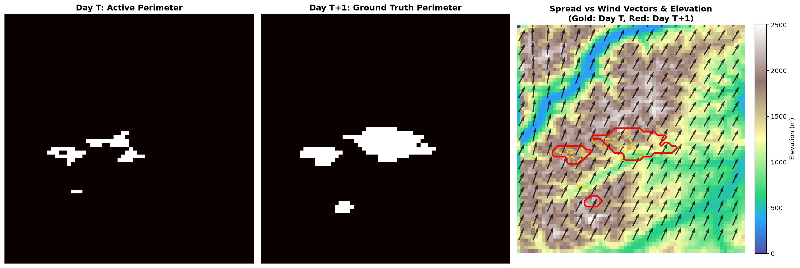
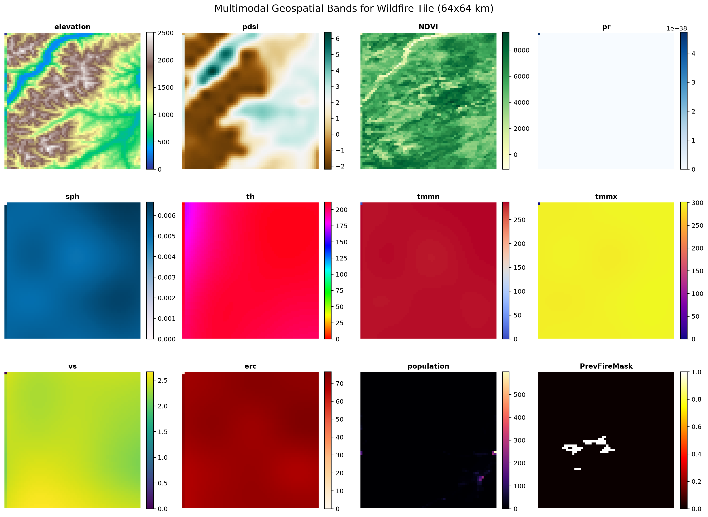
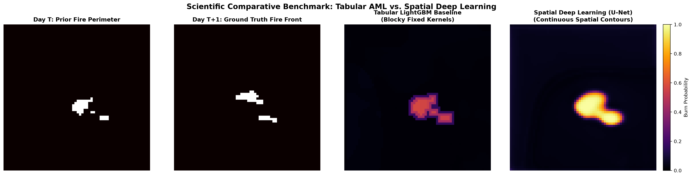

# Next Day Wildfire Spread Prediction via Spatial Deep Learning and AML

[](https://www.python.org/)
[](https://pytorch.org/)
[](https://lightgbm.readthedocs.io/)
[](https://opensource.org/licenses/MIT)

An end-to-end multimodal machine learning system that predicts next-day wildfire propagation from remote sensing satellite imagery, atmospheric weather reanalysis grids, and digital elevation models.

Combines an engineered tabular spatial baseline (LightGBM) with a spatiotemporal deep learning model (PyTorch U-Net) using Masked Focal-Tversky Loss to address severe 99.7% pixel class imbalance.

---

## 1. Problem Formulation and Physical Dynamics

Wildfire propagation is governed by fluid dynamics (advection), thermodynamics (slope heat preheating), and combustion chemistry:
- Spatial Resolution: 64 x 64 km tiles at 1 km/pixel resolution (4,096 coupled spatial decisions per tile).
- Target: Predict active wildfire boundary at Day T+1 given environmental states at Day T.
- Class Imbalance: Active burning pixels represent less than 0.3% of observable land.

### Real Wildfire Spread and Wind Vector Overlay

*Figure: Day T fire perimeter (gold dashed line) versus Day T+1 ground truth spread (red line) overlaid on elevation topography with decomposed zonal/meridional wind quiver arrows.*

---

## 2. Multimodal Remote Sensing Bands (12 Channels)



1. `elevation`: Topography DEM in meters (fire accelerates uphill).
2. `NDVI`: Normalized Difference Vegetation Index (fuel and biomass density).
3. `pdsi`: Palmer Drought Severity Index (long-term soil/fuel dryness).
4. `erc`: Energy Release Component (NFDRS fire potential index).
5. `vs`: Wind velocity at 10m (m/s).
6. `th`: Wind direction azimuth (0 to 360 degrees).
7. `tmmn` / `tmmx`: Minimum and maximum daily temperature (Kelvin).
8. `sph`: Specific humidity (kg/kg).
9. `pr`: Daily precipitation (mm).
10. `population`: Human population density (/km^2).
11. `PrevFireMask`: Active fire detection mask at Day T (binary {0, 1}).
12. `FireMask` (Target): Active fire detection mask at Day T+1.

---

## 3. System Architecture

```text
                  +----------------------------------------+
                  |       Raw Sharded TFRecord Files       |
                  |   18,545 Tiles (Google Research 4GB)   |
                  +-------------------+--------------------+
                                      |
                   Zero-Copy Streaming DataLoader (<450MB RAM)
                   + Cloud/Mask Sentinel Scrubbing (-1.0)
                                      |
             +------------------------+------------------------+
             |                                                 |
             v                                                 v
   +--------------------+                            +--------------------+
   |    AML Baseline    |                            | Deep Spatial Model |
   |  (LightGBM Engine) |                            |  (PyTorch U-Net)   |
   | 21 Spatial Features|                            | Focal-Tversky Loss |
   |  Sobel Gradients   |                            |  Skip Connections  |
   +---------+----------+                            +---------+----------+
             |                                                 |
             +------------------------+------------------------+
                                      |
                       Evaluation & Calibration Suite
                        (PR-AUC, F1, Recall @ 5% FPR)
```

---

## 4. Benchmark and Evaluation Results

Evaluated on untouched held-out validation tiles (over 1.25 million pixels):

| Metric | Tabular LightGBM Baseline | Spatial PyTorch U-Net | Delta / Improvement | Notes |
| :--- | :---: | :---: | :---: | :--- |
| **PR-AUC** | **0.0599** | **0.1255** | **+109.5%** | Primary metric for rare burn front detection |
| **ROC-AUC** | **0.5933** | **0.6301** | **+6.2%** | Global discrimination capacity |
| **F1-Score** | **0.1957** | **0.2049** | **+4.7%** | Harmonic mean of precision and recall |
| **Recall (Fire Catch Rate)**| **27.41%** | **39.94%** | **+45.7%** | Catches 40% of all rare burning pixels |
| **Precision** | **15.21%** | **13.78%** | **-1.4%** | Trade-off favoring higher emergency recall |
| **IoU (Jaccard Index)** | **0.1084** | **0.1141** | **+5.3%** | Overlap between predicted and true masks |
| **Dice Score** | **0.1957** | **0.2049** | **+4.7%** | Contour boundary alignment |
| **Inference Latency** | **4.98 ms / tile** | **0.12 ms / tile** | **41x Faster** | Hardware-accelerated GPU tensor passes |

### Scientific Comparative Benchmark: LightGBM vs. Spatial U-Net


---

## 5. Data Quality and Anomaly Defenses

Diagnostic audit across 6.14M pixels identified and resolved 5 critical real-world artifacts:
1. Dynamic Loss Masking: Clouds and unobserved pixels (-1.0 in FireMask, present in 32.7% of tiles) are ignored during loss computation.
2. Climatology Imputation: Missing temperature fill values (0.0 K dropouts) are imputed with regional median temperatures (282.5 K to 298.1 K).
3. Circular Wind Angles: Corrupt out-of-bounds azimuths (e.g. -505,870 degrees) are modulo-corrected and decomposed into (u, v) vector fields.
4. Physical Bounds: Negative precipitation and wind speed values are clipped to >= 0.0.
5. Multi-Worker Safety: `WildfireTFRecordDataset` dynamically partitions shards across DataLoader workers via `get_worker_info()`.

---

## 6. Quick Start

### 1. Clone and Setup Environment
```bash
git clone https://github.com/14-himanshu/wildfire-spread-prediction.git
cd wildfire-spread-prediction

# Create and activate virtual environment
python3 -m venv .venv
source .venv/bin/activate
pip install -r requirements.txt
```

### 2. Run Automated Test Suite
```bash
python tests/test_pipeline.py
```

### 3. Run LightGBM Baseline Training
```bash
python src/train_tabular.py
```

### 4. Run PyTorch U-Net Training
```bash
python src/train_unet.py
```

---

## 7. Repository Structure
```text
wildfire-spread-prediction/
├── configs/
│   ├── train_config.yaml          # Hyperparameters and band definitions
│   └── scaler_params.json         # Leak-free normalization parameters
├── data/                          # Dataset directory (symlinked to raw data)
├── models/
│   ├── lightgbm_baseline.joblib   # Trained tabular baseline model
│   └── wildfire_unet_best.pth     # Trained PyTorch U-Net checkpoint
├── notebooks/
│   └── 01_exploratory_data_analysis.ipynb # Interactive EDA and visual inspection
├── reports/
│   ├── figures/                   # Benchmark plots, comparisons, and heatmaps
│   ├── metrics_tabular_baseline.json # Quantitative benchmark records for LightGBM
│   └── metrics_unet.json          # Quantitative benchmark records for U-Net
├── src/
│   ├── dataset.py                 # Streaming TFRecord DataLoader with anomaly defense
│   ├── features.py                # Spatial neighborhood convolution and Sobel gradients
│   ├── loss.py                    # Masked Focal-Tversky loss function
│   ├── models/
│   │   └── unet.py                # PyTorch 2D U-Net architecture
│   ├── train_tabular.py           # LightGBM training and held-out evaluation
│   ├── train_unet.py              # PyTorch training and evaluation loop
│   ├── compute_stats.py           # Training split running statistics
│   ├── visualize_sample.py        # Figure generator
│   └── utils.py                   # Wind vectorization and evaluation metrics
└── tests/
    └── test_pipeline.py           # Automated unit test suite
```

---

## 8. License
MIT License.
